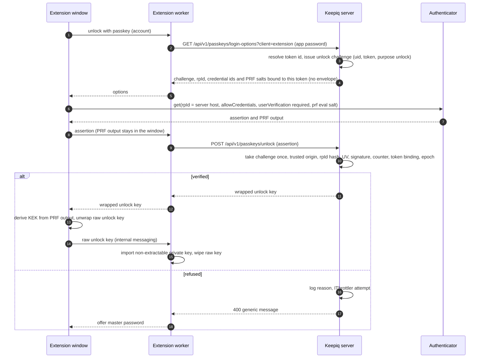
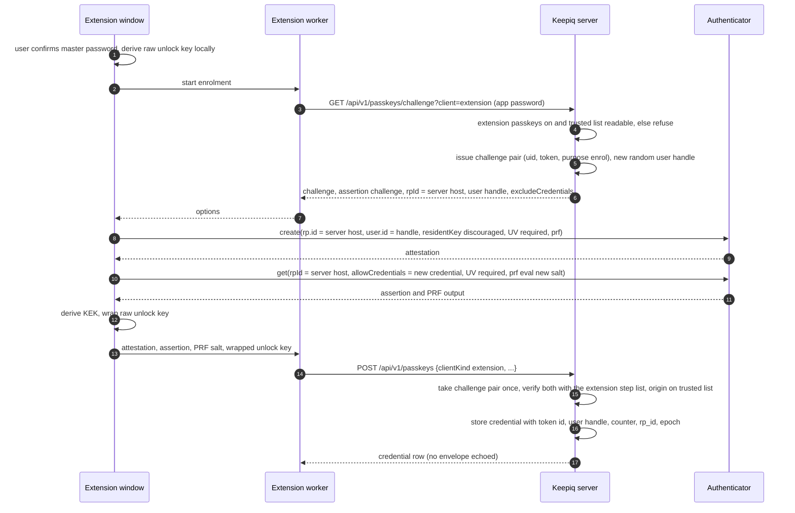
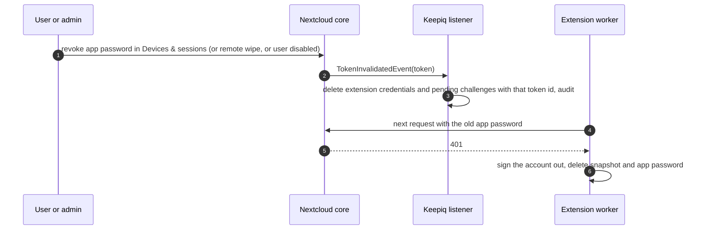

# Design: passkey enrolment and unlock in the browser extension

## Context

Code at development `e4fedf0fc` (keepiq#1614 merged):

- `lib/Service/WebAuthnVerifier.php` verifies an enrolment with core's web-auth/webauthn-lib 4.9: the `create()` attestation (client data type, challenge, origin, relying party hash, user presence, algorithm ES256 or RS256, attestation `none`) and a `get()` proof assertion of the same credential (credential id, user handle, signature, counter). It builds its ceremonies with `CeremonyStepManagerFactory`, whose `CheckOrigin` step requires an `https` origin whose host equals the relying party id or is a subdomain of it.
- `lib/Service/PasskeyChallengeStore.php` keeps the challenge pair in `ISession` under `keepiq_passkey_enrolment`, bound to the uid, taken once, 300 seconds.
- `lib/Service/PasskeyEnrolmentCeremony.php` verifies a web credential against the server host (`IRequest::getServerHost()` without port, as core does) and an extension credential against the `rpId` the client sent (`PasskeyService::enroll`, `assertClientBinding`).
- `lib/Service/PasskeyService.php::loginOptions` returns the active credentials of one client kind with their PRF salt and wrapped unlock key, and a fresh challenge that nothing checks yet. The follow-up unlock lane changes this to verify-before-release.
- `browser-extension/src/api/client.ts` sends `Authorization: Basic <loginName:appPassword>` with `credentials: 'omit'` (spec `extension-pairing`). The user pastes the app password (`entrypoints/popup/views/AddAccount.tsx`); the mobile apps already use Login Flow v2.
- `browser-extension/wxt.config.ts` requests the server origin as an optional host permission when an account is added, sets the Firefox add-on id `keepiq@conduction.nl`, and shows biometric unlock as "not available yet" (`AccountSecurity.tsx`). No extension credential has been enrolled through a shipped build.
- Core: `core/Controller/WebAuthnController.php` and `lib/private/Authentication/WebAuthn/Manager.php` use the request host as relying party id and keep ceremony state in the session. `ClientFlowLoginV2Controller` issues app passwords. `OCP\Authentication\Token\IProvider::getToken()` and `IToken::getId()` identify an app password; `OCP\Authentication\Events\TokenInvalidatedEvent` (Nextcloud 32, Keepiq's minimum) fires when one is revoked. `OCP\Security\Bruteforce\IThrottler` throttles by action and IP.

Browser behaviour this design relies on, from MDN "Use the Web Authn API in web extensions" and the Firefox WebAuthn extension tests:

- Chrome 122 and Firefox 150 let an extension page call `navigator.credentials.create()` and `get()` with `rp.id` set to any domain covered by the extension's granted host permissions. Chrome allows parent domains of a host pattern up to the registrable domain.
- The client data origin is the extension's own origin: `chrome-extension://<32 letters a-p>` on Chromium, and on Firefox `moz-extension://<64 letters a-p>` derived from the SHA-256 of the add-on id, so the same for every user, unlike the random per-install page URL.
- Firefox refuses the extension's own id or origin hash as relying party id. Its popup closes while the OS prompt is up (Mozilla bug 2026687), so ceremonies run in an extension tab or window.
- Related Origin Requests (`/.well-known/webauthn`) let other `https` web origins use one relying party id. They do not cover extension origins, and Firefox support is not settled.

## Goals / non-goals

**Goals**
- The extension enrols and unlocks with a PRF passkey on Chrome 122+ (and Edge on the same engine) and Firefox 150+, verified on the server by the same library and checks as the web app.
- The server decides the relying party and which extension builds it trusts, and fails closed.
- An extension credential cannot outlive the app password it was enrolled under.
- The vault envelope is released only after a verified assertion.

**Non-goals**
- Safari. Until its extension origin and relying party rules are checked, it keeps the master password only (feature detection, `extension-biometric-unlock`).
- Signing in to Nextcloud itself with a passkey from the extension. The extension keeps authenticating with an app password.
- Offline passkey unlock.
- Changing the web app's passkey flow, which keeps its session-held challenge.

## Decisions

### D1: The relying party is the Nextcloud host; the extension origin is trusted explicitly

**Recommended (A).** The extension runs both ceremonies with `rp.id` (create) and `rpId` (get) set to the host of its paired server, without port. The server computes that id itself (`IRequest::getServerHost()` without port, as core does) and verifies against it; a `rpId` in the request is ignored. The browser puts the extension's origin in the client data. The server accepts it only when it equals, as an exact string, one entry of the trusted extension origins (D2).

Server side, the library's `CheckOrigin` cannot express this: it compares the origin host with the relying party id, and an extension origin's host is the extension id. Keepiq builds the ceremony step list for extension ceremonies itself, from the library's own step classes, with `CheckOrigin` replaced by a Keepiq step `TrustedExtensionOrigin` that implements the library's `CeremonyStep` interface. Every other step (type, challenge, top origin, relying party hash, user presence, user verification, backup bits, algorithm, extensions, attestation format, credential id, signature, counter) is the library's. Web ceremonies keep the factory's step list unchanged.

The extension already holds host permission for its server, which is what the browser requires to use that domain as relying party id. The credential is stored with `rp_id` = that host; at unlock the request host must equal it.

Two details keep this credential separate from the user's other passkeys on the same relying party:
- **User handle.** The credential's `user.id` is a random 32-byte handle stored on the row, not the uid. Some platform authenticators replace a stored passkey that has the same relying party and user handle, so a uid handle could overwrite the user's Nextcloud sign-in passkey or their web vault passkey.
- **Not discoverable.** `residentKey: 'discouraged'`, and every `get()` names the credential in `allowCredentials`, so the credential is not offered on the Nextcloud login page and does not show as a sign-in choice.

**Alternative B: enrol in a normal tab on the Nextcloud origin, use it from the extension.** Enrolment then passes the library's origin check unchanged. But unlock from the extension still runs `get()` from the extension origin, so the server needs the trusted origin step anyway, and the extension would be offered a web credential, which `extension-biometric-unlock` forbids so a revoked browser cannot reuse the web app's passkey. It also sends the user through a tab and back. Kept as the route for a later Safari change if Safari turns out to allow `get()` but not `create()` from extension pages.

**Alternative C: an extension-scoped relying party (the extension id), as the spec says today.** Chrome accepts it, Firefox refuses it, and the server would still need the trusted origin list because the id is a client claim. Rejected: it cannot work on Firefox.

**Alternative D: Related Origin Requests.** The `/.well-known/webauthn` list on the relying party host names `https` web origins that may use its id. Extension origins are not covered, browser support differs, and it adds a file core would have to serve. Rejected.

### D2: Trusted extension origins are pinned per store build and extended by the admin, never by wildcard

**Recommended.** Keepiq ships a constant list of the origins of its official store builds: the Chrome Web Store id, the Edge Add-ons id (a different id for the same code) and the Firefox origin of `keepiq@conduction.nl`. Each is written as the exact origin string and checked by a unit test against the value the store build reports. An admin can:

- turn extension passkeys off for the instance (app config `extension_passkeys_enabled`, default on);
- add origins for builds the instance runs itself, such as an enterprise-signed or self-built extension (app config `extension_passkey_origins`, a JSON list).

Each admin entry must match `chrome-extension://[a-p]{32}` or `moz-extension://[a-p]{64}` exactly, with no path, no trailing slash and no wildcard; anything else is refused when the setting is saved, with a message naming the entry. The admin section shows the pinned list read-only next to the added entries, and offers a field that turns a Firefox add-on id into its origin, so nobody hand-types a hash.

**Fail closed.** The trusted list is the pinned list plus the admin list. Extension ceremonies are refused when the switch is off, when the admin value cannot be parsed (the pinned list does not stand in for a broken value, because an admin who wrote a value meant to change it), or when the origin is not on the list. A refusal is logged with the failed check, answered with the generic "The passkey could not be verified", and counts as a throttled attempt (D6). The master password path is never affected. Removing an origin from the list stops its credentials at their next unlock, because the origin is checked on every assertion, not only at enrolment.

**Alternative: admin list only, nothing pinned.** Each admin has to look up and type the store ids, and an instance that never does gets no extension passkeys. Rejected as the default; an admin who wants this can turn the switch off and add only their own build.

**Alternative: trust any extension that presents a valid app password.** Any extension the user installed with host permission for the server could then enrol under the Nextcloud relying party. Rejected.

**Alternative: allow `chrome-extension://*`.** Same problem. Rejected.

### D3: The extension pairs through Login Flow v2 and its app password is the device

**Recommended.** Adding an account starts core's Login Flow v2: the extension calls `POST <server>/index.php/login/v2`, opens the returned login URL in a tab, and polls the returned endpoint with its token until it gets the login name and app password, or 20 minutes pass, or the user closes the tab. The user signs in on Nextcloud's own page, with two-factor and SSO as the instance configures. Pasting an app password stays as a fallback, as in the mobile apps. Every request then authenticates with Basic auth and the app password and sends no cookies, as today.

At `POST /api/v1/extension/pair` the server resolves the app password to its core token id (`IProvider::getToken()` on the app password core recorded for this request, `IToken::getId()`) and keeps it on the request; nothing new is stored at pairing. Keepiq refuses passkey enrolment and unlock from a request that did not authenticate with an app password, so a browser session cookie never reaches these routes.

What limits a stolen extension session:
- **The vault stays end-to-end encrypted.** An app password alone gives ciphertext and wrapped envelopes, not secrets (ADR-003).
- **The envelope needs the authenticator.** Under D5 the wrapped unlock key is released only after a fresh assertion with user verification from the enrolled authenticator.
- **Binding.** An extension credential stores the token id it was enrolled under. Its unlock options, challenge and envelope are given only to requests authenticated with that same app password. A web session or another app password of the same user gets none of them.
- **Revocation in Nextcloud.** The app password appears in the user's Devices & sessions under the name core gives it. Revoking it there (or an admin revoking the user's sessions, or a remote wipe) fires `TokenInvalidatedEvent`; Keepiq's listener deletes the extension credentials and pending challenges bound to that token id. The extension's next request gets 401 and signs the account out (`extension-pairing`).
- **Throttling.** D6.

Nextcloud has no per-app scope for app passwords; its only scope switch is filesystem access. The pairing screen tells the user that the extension does not need file access and links to Devices & sessions, where they can switch it off. Keepiq does not change the token itself, because core offers no public API for that.

**Alternative: keep pasting app passwords only.** Works, but users create app passwords by hand, often reuse one across clients, and the binding then covers several devices. Rejected as the default.

**Alternative: a Keepiq-issued extension token.** A second credential system next to Nextcloud's. Rejected by the rule to build on Nextcloud security first.

### D4: Extension challenges live in a server-side store bound to the app password

The session store cannot serve the extension (Why, point 3). **Recommended:** a table `keepiq_webauthn_challenges` with `id`, `uid`, `token_id`, `purpose` (`enrol` or `unlock`), the challenge bytes (and for `enrol` the assertion challenge), `credential_id` for an unlock, and `expires_at`. Issuing a challenge replaces any pending one for the same uid, token and purpose. Taking it is one `DELETE` of that row; only the request whose delete removed the row may verify, so a challenge is spent exactly once even under parallel requests. A pending challenge expires after 300 seconds, like the session store. A background job removes expired rows. Challenges come from `ISecureRandom` (32 bytes), time from `ITimeFactory`.

**Alternative: a distributed memcache with compare-and-delete (`IMemcache::cad`).** Atomic, but an instance without a configured distributed cache falls back to a cache that keeps nothing, which turns every ceremony into a refusal that looks like a broken feature. Rejected.

**Alternative: a stateless challenge signed with `ICrypto`.** Needs a list of spent challenges for single use, which is a store again. Rejected.

### D5: Unlock from the extension is verify-before-release

The route names follow the unlock lane; if it settles on other names, this change uses those. The server checks, in order: the challenge was taken by this request and was issued to this uid and token for `unlock`; the credential is `active`, `client_kind` `extension`, bound to this token id, its `rp_id` equals the request host and its epoch is the suite's current one; the assertion passes the extension step list (D1) with `userVerification` `required`; the signature counter rule (threats table) holds. Only then does it return the wrapped unlock key, store the new counter and last-used time, and write an audit event. The PRF output, the key-encryption key and the raw unlock key never leave the extension.

### D6: Throttling and audit use Nextcloud's own services

Every refused enrolment or unlock registers an attempt with `IThrottler` under the actions `keepiq_passkey_enrol` and `keepiq_passkey_unlock`, and both routes call `sleepDelayOrThrowOnMax` before verifying, so repeated failures slow down and then stop per IP, as core's login does. A verified unlock resets the delay for that action. Enrolment, unlock, refusal (with the failed check, never the assertion) and revocation by token are written to Keepiq's audit trail.

## Enrolment

## Revocation

## Threats and how the design handles them

The table describes what each control prevents, not how an attack is carried out.

| Threat | What the design does |
|---|---|
| Another extension with a similar name or icon | Trust is the exact origin string the browser reports, which is derived from the store id or add-on id and cannot be chosen by the other extension. Names and icons play no part. Only pinned and admin-added origins pass (D2). |
| A web page posing as Keepiq | A web page's origin is `https://...`, never an extension origin, so it fails the trusted origin step. It also cannot use the Nextcloud host as relying party unless it is on that host. The credential is not discoverable, so it is not offered on other pages. |
| Replay of an enrolment or unlock | Challenges are random, bound to uid, token and purpose, taken once by an atomic delete and valid 300 seconds (D4). The client data type is checked per ceremony, so an enrolment assertion cannot serve as an unlock. |
| Signature counter going back | The server stores the counter. When the stored and the new counter are both 0, the authenticator does not count and the assertion is accepted (most synced passkeys). When either is above 0, the new counter must be higher; otherwise the unlock is refused, the credential is set `suspended`, the user is notified and must revoke or confirm it in the web app with the master password. |
| Lost or stolen device | The user revokes the app password in Devices & sessions (D3, revocation diagram) or the credential in the web app's passkey list. Either removes the envelope on the server. The thief also needs the user's fingerprint, face or device PIN, because user verification is required. |
| User disabled or removed by an admin | Core refuses the app password of a disabled user, so no Keepiq route is reached. Revoking the user's sessions fires `TokenInvalidatedEvent`. A deleted user's credentials go with Keepiq's existing user deletion handling. |
| Credential enrolled under one app password used under another | The token id binding refuses it (D3). |
| A broken or emptied trusted origin setting | Extension ceremonies are refused, never opened up (D2). |
| Many wrong attempts | `IThrottler` slows and then blocks per IP (D6). |
| A web vault passkey or Nextcloud sign-in passkey overwritten | Random user handle and a non-discoverable credential (D1). |

## Building on Nextcloud security first

| Need | Nextcloud piece used | Keepiq adds |
|---|---|---|
| Getting a credential for the extension | Login Flow v2, app passwords | nothing |
| Request authentication | core's Basic auth with an app password | a check that passkey routes were reached with an app password |
| Revocation and the device list | Devices & sessions, `TokenInvalidatedEvent` | a listener that deletes bound credentials |
| Brute force | `IThrottler` | two action names |
| Randomness and time | `ISecureRandom`, `ITimeFactory` | nothing |
| WebAuthn verification | the webauthn-lib core ships, its step classes | one origin step for extension ceremonies |
| Settings | `IAppConfig` through `AdminSettingsService` | two keys |

No Keepiq session, token or login exists next to Nextcloud's.

## Migration

`keepiq_passkey_credentials` gains `token_id` (nullable bigint), `user_handle` (nullable string) and `sign_count` (int, default 0). Existing rows with `client_kind` `extension` were enrolled against the extension's own relying party, which this design no longer accepts; the migration marks them `stale`, so the user is asked to enrol again. No shipped build enrolled one, so none are expected. Web credentials are not touched.

## Risks and open points

- **The token id comes from the app password core recorded for the request.** If core stops exposing it, the binding falls back to refusing extension passkeys rather than to accepting unbound ones.
- **Store ids.** The Chrome Web Store and Edge Add-ons ids must be read from the published listings before the pinned list is written; a wrong pinned id refuses every user of that store, which fails closed but visibly.
- **Firefox origin derivation.** MDN describes the hash only in words; the build records a test vector taken from a real Firefox 150 ceremony.
- **Browsers older than Chrome 122 or Firefox 150** refuse the host-permission relying party; feature detection hides the passkey option there.
- **Several Nextcloud hostnames.** An instance reachable under several trusted domains gives the credential the host of the server address the extension paired with. Unlock through another hostname is refused.
